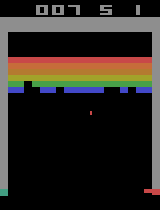
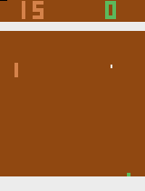

   

# Atari com PPO

Projeto pessoal em que exploro o aprendizado por reforço treinando agentes para jogar Breakout e Pong, dois jogos clássicos do Atari. Uso o algoritmo PPO (Proximal Policy Optimization), implementado pelo Stable-Baselines3, em ambientes Atari acessados pelo Gymnasium.

| Breakout | Pong |
|:---:|:---:|
|  |  |

## Requisitos

- Python 3.10 ou superior
- Dependências listadas em `requirements.txt`
- Para assistir aos jogos, um ambiente gráfico compatível com a janela de renderização do Gymnasium

## Instalação

Clone o repositório e entre na pasta do projeto:

```bash
git clone https://github.com/edu-lara/atari
cd atari
```

Dentro da pasta `atari`, crie e ative um ambiente virtual e instale as dependências:

```bash
python -m venv .venv
source .venv/bin/activate  # Windows: .venv\Scripts\activate
pip install -r requirements.txt
```

## Uso

Execute os comandos na raiz da pasta `atari` e siga os passos:

1. **Treine um jogo.**

   Escolha Breakout ou Pong no bloco e deixe ativo somente o comando do jogo desejado:

   ```bash
   # Breakout
   python treinar_breakout.py

   # Para treinar Pong, comente a linha de Breakout e descomente esta:
   # python treinar_pong.py
   ```

   O programa pedirá um número inteiro positivo de passos adicionais de treinamento. Eles serão somados ao progresso do modelo atual ou do checkpoint mais recente, se existir.

   Como referência da minha experiência, comecei com execuções de **100 mil passos** e depois **250 mil passos** para observar o tempo de processamento e o comportamento do agente. No meu computador com Apple Silicon (M1), comecei a notar mudanças mais claras depois de ultrapassar **1 milhão de passos acumulados**, após cerca de **1h30 de treinamento** e usando paralelismo. Esse tempo varia conforme o os componentes do seu computador e as configurações do treino.
   
   O contador pode passar um pouco do valor informado para concluir um ciclo do PPO; fique tranquilo.
   
   E pressione `q` durante o treinamento para solicitar uma parada segura e salvar o modelo atual.

2. **Avalie o modelo.**

   O script compara o agente treinado com um agente aleatório em 30 partidas. Use o jogo correspondente ao que treinou:

   ```bash
   # Breakout
   python avaliar_breakout.py

   # Para avaliar Pong, comente a linha de Breakout e descomente esta:
   # python avaliar_pong.py
   ```

3. **Assista ao agente.**

   Para assistir ao agente, é necessário um ambiente gráfico. O script procura primeiro o melhor modelo (`breakout_melhor/best_model.zip` ou `pong_melhor/best_model.zip`) e, se não o encontrar, carrega o modelo atual em `modelos/`. Assim, você pode observar o comportamento aprendido durante o treinamento.

   ```bash
   # Breakout
   python assistir_breakout.py

   # Para assistir ao Pong, comente a linha de Breakout e descomente esta:
   # python assistir_pong.py
   ```

4. **Experimente os testes e diagnósticos.**

   Os testes abrem os jogos com ações aleatórias; os diagnósticos comparam partidas com decisões determinísticas e probabilísticas.

   ```bash
   # Teste aleatório de Breakout
   python testar_breakout.py
   # Para testar Pong, comente a linha acima e descomente esta:
   # python testar_pong.py

   # Diagnóstico de Breakout
   python diagnosticar_breakout.py
   # Para diagnosticar Pong, comente a linha acima e descomente esta:
   # python diagnosticar_pong.py
   ```

### Entender a tabela de treinamento

Durante o treino, o Stable-Baselines3 imprime periodicamente uma tabela no terminal. Os nomes aparecem agrupados por categoria, como `rollout/`, `time/` e `train/`. As métricas mais úteis para acompanhar são:

| Métrica | O que indica |
|---|---|
| `rollout/ep_rew_mean` | Recompensa média das partidas recentes. No treino, as recompensas são recortadas para estabilizar o PPO; use os scripts de avaliação para comparar pontuações das partidas completas. |
| `rollout/ep_len_mean` | Duração média das partidas recentes, em passos. |
| `time/total_timesteps` | Total de passos de interação acumulados pelo agente, somando os ambientes paralelos. |
| `time/fps` | Velocidade aproximada do treino, em passos por segundo. |
| `time/iterations` | Ciclos de coleta de dados e atualização do PPO concluídos. |
| `train/approx_kl` e `train/clip_fraction` | Indicadores de quanto as atualizações da política estão mudando as decisões do agente. |
| `train/explained_variance` | Indica o quanto a função de valor prevê as recompensas; valores mais próximos de 1 geralmente indicam previsões melhores. |

Observe a tendência das métricas ao longo de várias linhas, em vez de interpretar um único valor isolado. A recompensa de treino não é diretamente a pontuação final do jogo.

## Arquivos e resultados

- `ambientes_atari.py`: configuração compartilhada dos ambientes de treino, com quatro frames empilhados.
- `treinar_*.py`: treinamento PPO, checkpoints periódicos e avaliação durante o treino.
- `avaliar_*.py`, `assistir_*.py`, `diagnosticar_*.py`, `testar_*.py`: ferramentas para medir, visualizar e inspecionar os agentes.
- `modelos/`: modelos atuais e checkpoints gerados durante o treinamento.
- `breakout_melhor/` e `pong_melhor/`: melhor modelo encontrado nas avaliações periódicas.
- `logs/`: registros do TensorBoard e resultados das avaliações.

Modelos e logs são artefatos gerados localmente e estão excluídos do Git por `.gitignore`.

## Cinco jogos para treinar

Esta é uma ordem sugerida para começar, dos jogos mais simples aos de complexidade moderada:

1. Breakout.
2. Pong.
3. Enduro.
4. Space Invaders.
5. Seaquest.

Os scripts atuais treinam Breakout e Pong. Para treinar outro jogo, é preciso adaptar o identificador do ambiente e os caminhos dos modelos nos scripts. Você pode consultar a [lista oficial de ambientes Atari do ALE](https://ale.farama.org/environments/) para ver outras opções.

O pacote `ale-py`, instalado por `requirements.txt`, já inclui os ROMs suportados. Não é necessário baixar ou instalar cada jogo separadamente. Para listar os nomes disponíveis:

```python
from ale_py.registration import rom_id_to_name
from ale_py.roms import get_all_rom_ids

nomes = sorted(rom_id_to_name(rom_id) for rom_id in get_all_rom_ids())
print("\n".join(nomes))
```

Para abrir Enduro e executar algumas ações aleatórias, salve como `experimentar_enduro.py` e rode `python experimentar_enduro.py`:

```python
import ale_py
import gymnasium as gym

gym.register_envs(ale_py)
env = gym.make("ALE/Enduro-v5", render_mode="human")

try:
    observacao, info = env.reset()
    for _ in range(500):
        acao = env.action_space.sample()
        observacao, recompensa, terminou, limite, info = env.step(acao)
        if terminou or limite:
            observacao, info = env.reset()
finally:
    env.close()
```

## Lições aprendidas

Neste projeto, aprendi conceitos de aprendizado de máquina por meio de experimentos práticos com aprendizado por reforço. Treinar e avaliar os agentes na minha máquina mostrou que esse processo exige muitas interações com o ambiente e que as recompensas orientam as ações que o agente aprende a tomar.

O processamento paralelo ajudou a executar os experimentos, mas também aumentou a carga e a temperatura do computador. Isso me ensinou a considerar o uso de recursos computacionais e a importância de manter o equipamento bem resfriado durante treinos longos.

Além de observar se os agentes conseguiam vencer, meu objetivo era entender como aprendem por tentativa e erro, usando observações, ações e recompensas.

Por fim, o aprendizado por reforço exige tempo, esforço e recursos computacionais. Em algumas tarefas, esses conceitos podem ser adaptados para que um agente tome decisões sem intervenção humana a cada etapa. Isso depende de como o problema, as recompensas e a definicação dos limites do agente foram configurados.

## TensorBoard

Para acompanhar as métricas de treino:

```bash
tensorboard --logdir logs
```

Depois, abra no navegador o endereço informado pelo TensorBoard.

## Licença

O código-fonte deste projeto está disponível sob a licença MIT. Consulte o arquivo [LICENSE](LICENSE) para ver o texto completo.

