   

# Atari com PPO

Projeto pessoal em que estudo o aprendizado por reforço treinando agentes com PPO (Proximal Policy Optimization) e Stable-Baselines3, em ambientes Atari acessados pelo Gymnasium e pelo [Arcade Learning Environment (ALE)](https://ale.farama.org/).

## Jogos utilizados

| Freeway | Atlantis | Video Pinball |
|:---:|:---:|:---:|
| 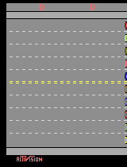 | 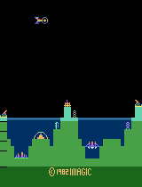 | 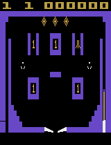 |
| Pong | Breakout | Enduro |
| 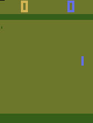 | 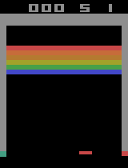 | 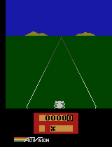 |

## Requisitos

- Python 3.10 ou superior
- Dependências listadas em `requirements.txt`
- Para assistir aos jogos, um ambiente gráfico compatível com a janela de renderização do Gymnasium

## Instalação

Clone o repositório e entre na pasta do projeto:

```bash
git clone https://github.com/edu-lara/atari
cd atari
```

Dentro da pasta `atari`, crie e ative um ambiente virtual e instale as dependências:

```bash
python -m venv .venv
source .venv/bin/activate  # Windows: .venv\Scripts\activate
pip install -r requirements.txt
```

## Uso

### Menu

Execute o comando na raiz da pasta `atari` e siga as instruções:

```bash
python menu.py
```

```text
+--------------------------------+
| O que deseja fazer?            |
| 1. Treinar                     |
| 2. Assistir                    |
| 3. Avaliar                     |
| 4. Diagnosticar                |
| 5. Simular ambiente            |
| 0. Sair                        |
+--------------------------------+
```

### Treinar

Essa seção treina um agente PPO para o jogo escolhido. Para isso, o programa pergunta quantos passos adicionais você deseja executar. Se pressionar Enter, o padrão é 100.000 passos.

> [!NOTE]
> O treinamento continua a partir do modelo salvo ou do checkpoint mais recente. Pressione `Q` para encerrar e salvar o modelo; `Ctrl+C` também salva.

### Assistir

Essa seção abre uma partida do agente para você observar como ele joga.

> [!NOTE]
> É necessário um ambiente gráfico e um modelo treinado para o jogo escolhido. O terminal mostra o caminho do modelo e os passos de treinamento realizados.

### Avaliar

Essa seção compara o agente treinado com um agente que escolhe ações aleatórias. O programa executa 10 partidas por agente, ou 5 para Video Pinball, e mostra o progresso e os resultados no terminal.

### Diagnosticar

Essa seção executa automaticamente os dois modos de decisão do agente:

- **Determinístico:** escolhe a ação mais provável.
- **Probabilístico:** amostra uma ação.

### Simular ambiente

Essa seção abre o ambiente escolhido e simula até 450 passos com ações aleatórias.

> [!NOTE]
> Como essa opção não usa um modelo treinado, ela serve para conferir o ambiente e ver como é o jogo.

## Entender a tabela de treinamento

O Stable-Baselines3 atualiza a tabela periodicamente. Os valores grandes podem aparecer em notação científica: `1.2e+04` significa 12.000.

| Métrica | Significado |
|---|---|
| `rollout/ep_rew_mean` | Recompensa média das partidas registrada pelo Monitor; pode mostrar a pontuação original, mesmo que o PPO aprenda com recompensa recortada. |
| `rollout/ep_len_mean` | Duração média em passos do ambiente; o frame skip faz cada decisão avançar quatro frames. |
| `time/total_timesteps` | Passos acumulados pelo agente. |
| `time/fps` | Velocidade aproximada do treinamento. |

A tabela também mostra a meta acumulada, o tempo decorrido e a estimativa de tempo restante.

## Arquivos e resultados

- `menu.py`: menu principal.
- `jogos.py`: lista de jogos e menu de seleção compartilhado.
- `ambientes_atari.py`: configuração dos ambientes de treinamento.
- `terminal.py`: limpeza de tela e funções de interação no terminal.
- `treinar.py`, `assistir.py`, `avaliar.py`, `diagnosticar.py`, `simular.py`: ferramentas do projeto.
- `modelos/<jogo>_atual.zip`: modelo atual de cada jogo.
- `modelos/<jogo>_melhor/best_model.zip`: melhor modelo salvo nas avaliações periódicas.
- `modelos/<jogo>_*_steps.zip`: checkpoints; ao fim de cada sessão, ficam os dois mais recentes.
- `logs/`: registros do treinamento, avaliações e TensorBoard.

Os nomes usados nos caminhos são `freeway`, `atlantis`, `video_pinball`, `pong` e `breakout`.

Modelos e logs são gerados localmente e ignorados pelo Git.

## TensorBoard

Para acompanhar os registros do treinamento, execute:

```bash
tensorboard --logdir logs
```

## Lições aprendidas

Neste projeto, aprendi na prática os conceitos de aprendizado de máquina por meio de experimentos com aprendizado por reforço.

Entendi que treinar e avaliar os agentes é um processo que exige muitas interações com o ambiente e que as recompensas orientam as ações para que o agente aprenda a tomar uma decisão sozinho.

Ativar o processamento paralelo acelerou os treinamentos, mas também aumentou a carga de processamento e a temperatura do computador, especialmente em treinos longos, como os de `1 milhão de passos`. Isso me ensinou a usar os recursos computacionais com consciência e a manter o equipamento resfriado durante essas execuções.

Além de observar se os agentes conseguiam vencer, meu objetivo também era entender como aprendiam por tentativa e erro. Para isso, assistia ao comportamento deles e observava as ações e recompensas ao final de cada treinamento.

Percebi que a quantidade de informações de cada jogo e os comandos disponíveis influenciam a complexidade do aprendizado. Movimentos horizontais e verticais, além do uso de botões, podem tornar o aprendizado mais difícil e demorado.

No meu experimento com `Freeway`, foram necessários cerca de `250 mil passos` para o agente conseguir atravessar a rua com a galinha sem ser atropelada. Acredito que isso aconteceu porque os comandos são simples: o agente só precisa se movimentar para cima ou para baixo.

No início, o agente não sabe qual opção é melhor. Ao longo de milhares ou milhões de interações, o PPO ajusta as probabilidades de escolher cada ação em situações semelhantes.

Por exemplo, depois de aprender, para uma determinada situação, ele poderia atribuir probabilidades como estas:

| Ação | Probabilidade |
|---|---|
| Subir | 15% |
| Esperar | 80% |
| Descer | 5% |


Isso não significa que ele sempre esperará. Durante o treinamento, o PPO normalmente amostra ações conforme as probabilidades da política, permitindo que o agente continue explorando.

### Como ele sabe que o carro está vindo?

Ele precisa aprender o movimento a partir de uma sequência de imagens. Essa técnica é chamada de `Frame Stacking`.

| Exemplo: quatro imagens consecutivas |
|:---:|
| 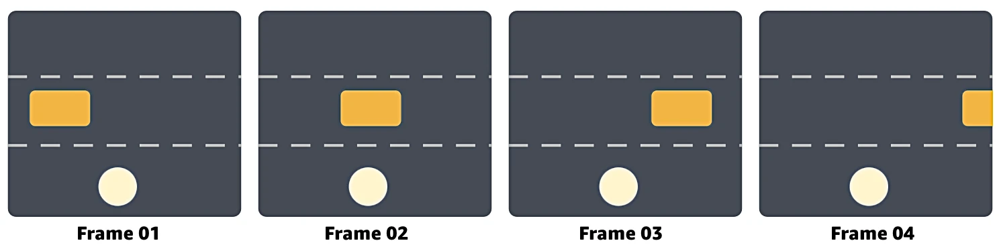 |
| O carro está se deslocando para a direita |

Ao receber as quatro imagens, a rede neural aprende os padrões de direção e velocidade, embora não calcule necessariamente esses valores de forma explícita.

### Mas a galinha continua sendo atropelada?

Sim. Inclusive depois de aprender.

Imagine que o agente tenha descoberto que subir costuma ser uma boa estratégia. Em determinadas situações, ele pode continuar escolhendo subir mesmo quando existe um carro se aproximando.

Isso acontece porque o aprendizado não produz obrigatoriamente uma regra perfeita.

Além disso, no Freeway, a recompensa principal vem quando a galinha atravessa a estrada. Ser atropelado não significa necessariamente receber uma recompensa negativa explícita, embora atrapalhe a obtenção de pontos.

O PPO aprende a maximizar a `recompensa acumulada esperada`. Portanto, ele pode descobrir que atravessar agressivamente, aceitando algumas colisões, produz mais pontos do que esperar por uma oportunidade completamente segura.

Foi exatamente isso que aconteceu no meu treinamento de `250 mil passos`: a galinha corria para tentar atravessar logo na primeira tentativa e, às vezes, voltava bruscamente até três vezes para evitar uma colisão.

### E depois que ele aprendeu, continua tentando aleatoriamente?

Existe uma diferença entre treinamento e execução.

| Durante o treinamento | Depois do treinamento |
|---|---|
| Explora diferentes ações | Utiliza a política aprendida |
| Atualiza a rede neural | Normalmente não atualiza a rede |
| Pode escolher ações menos prováveis | Pode selecionar a ação de maior probabilidade |
| Aprende com as recompensas | Aplica o que aprendeu |

No Stable-Baselines3, por exemplo, `model.predict(obs, deterministic=True)` permite escolher ações de forma determinística. Isso não significa que o agente sempre acerte, mas torna suas decisões mais consistentes.

Além disso, há incerteza sobre a posição futura dos carros e sobre as ações do agente. São duas coisas diferentes:

- **Incerteza sobre o ambiente:** o agente não sabe exatamente onde os carros estarão no futuro. Mesmo observando os frames anteriores, ainda há imprevisibilidade.

- **Probabilidade da política:** o agente atribui probabilidades às ações que pode executar, como subir ou esperar.

No teste simples, que usa o ambiente `ALE/Freeway-v5`, a configuração padrão de `sticky actions` tem 25% de chance de repetir a ação anterior. Já o treinamento usa o wrapper do Stable-Baselines3, que por padrão não repete ações dessa forma.

### Então, se o agente `enxerga`, por que não é bom em jogos de matemática?

Esse foi um dos questionamentos que fiz, porque queria que o agente jogasse `Basic Math`.

| Basic Math |
|:---:|
|  |

Mas o agente não interpreta números como valores matemáticos: ele recebe pixels. Essa diferença ajuda a explicar por que alguns jogos, como `Freeway`, foram mais fáceis de aprender do que outros, como este.

Imagine que o jogo apresente:

`3 + 4 = ?`

Nós reconhecemos imediatamente os números 3 e 4, entendemos o símbolo de adição e sabemos que a resposta é 7.

Mas a rede neural desse projeto não recebe os valores `3`, `4` e `+`.

Ela recebe uma matriz de pixels que representa a imagem da tela. Cada pixel contém uma informação numérica de intensidade ou cor, dependendo do pré-processamento.

Por exemplo, uma pequena região que representa o número 3 poderia ser codificada por pixels acesos, representados pelo número 1:

```text
0 1 1 1 0
0 0 0 1 0
0 1 1 1 0
0 0 0 1 0
0 1 1 1 0
```

Para a rede neural, isso é inicialmente apenas um padrão de pixels. Ela ainda não sabe que esse padrão representa o número três.

### Mas ele pode aprender matemática sozinho?

Em princípio, sim. Uma rede neural pode aprender a reconhecer algarismos e até determinadas relações aritméticas a partir de imagens.

O problema está na eficiência desse aprendizado.

Imagine que o agente acerte uma resposta. Ele recebe uma recompensa, mas precisa descobrir quais características da imagem e quais decisões contribuíram para o acerto.

No `Freeway`, a associação entre o movimento da galinha e o resultado (não colidir) tende a ser mais direta. Em `Basic Math`, acertar uma questão exige combinar reconhecimento visual e regras matemáticas.

Isso torna o aprendizado mais lento e menos confiável, especialmente quando queremos que o agente resolva questões que nunca encontrou.

### Conclusão

Este projeto nasceu do meu desejo nostálgico de rever os jogos que me divertiam na infância, como as incontáveis horas que pulei blocos de gelo no Ártico, em `Frostbite`, na caça ao bandido dentro de um shopping, no `Keystone Kapers`, do resgate de sobreviventes em uma caverna cheia de morcegos, em `H.E.R.O.` e na busca das pílulas piscantes nos labirintos de `Pac-Man`.

| Frostbite | Keystone Kapers | H.E.R.O. | Pac-Man |
|:---:|:---:|:---:|:---:|
| 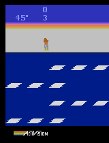 | 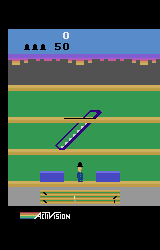 | 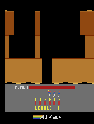 | 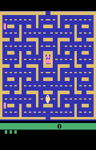 |


Enquanto estava revendo esses jogos e acompanhando os agentes jogando sozinho, comecei a refletir em como poderiamos desenvolver aplicações de aprendizado por reforço fora dos jogos de Atari. Por exemplo, em muitas tarefas repetitivas com informações 2D, podemos utilizar agentes autônomos treinados para nos ajudar com atividades rotineiras, como, reconhecer e fazer diagnósticos em raio-x, separação de objetos em mesas e esteiras, prevenir colisões e acidentes, como já ocorre nos carros modernos, com o objetivo de facilitar nossa vida e deixar o ambiente em nossa volta ainda mais seguro.

Claro que trabalhar com aprendizado por reforço exige tempo, esforço e recursos computacionais. E obter bons resultados dependem de ter um problema bem definido, das recompensas corretas que vão orientar o agente e de limites estabelecidos para suas decisões.

No final, deixo o desafio de você testar este projeto no seu equipamento e a provocação de pensar em desenvolver uma aplicação para resolver uma atividade repetitiva com o aprendizado de reforço.

## Licença

O código-fonte está disponível sob a licença MIT. Consulte [LICENSE](LICENSE).
